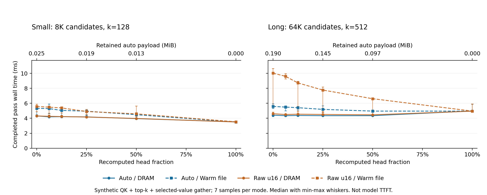

# Head recompute / tail selection cache: A100 split sweep

These are **synthetic QK + top-k/sort + selected-value gather** measurements, not model prefill latency or model TTFT. No production QSA kernel, complete attention, projection, MLP, GDN, or end-to-end model is measured.

NVIDIA A100-SXM4-80GB; PyTorch 2.8.0+cu128. Each mode has seven samples, interleaved in a seeded shuffled order; two replay buffers and prefetch are enabled. The associated A100 validation run passed **25 tests**. That count describes that run only, not later local test additions. All reported modes passed exact sorted-index and consumer-output checks.

The figure shows every sampled split and every codec/source combination. Markers are medians; whiskers are observed minima and maxima, not confidence intervals. Both panels share a zero-based runtime axis. The upper axes give auto-codec retained payload in MiB at selected splits; raw payloads are in the tables. Payload is **not** total runtime memory.

## Findings

For the long configuration, auto retained payload falls from **199,324 B** at head=0 to **151,682 B** at head=4 and **101,330 B** at head=8 (23.9% and 49.2% reductions). Corresponding DRAM medians are **4.416 → 4.348 / 4.348 ms**. This is a capacity/latency tradeoff with approximately unchanged observed latency; the roughly 1.5% median change has overlapping sample ranges and does not establish a significant speedup. Full recomputation is about 4.95–4.97 ms here. Warm-file auto medians also decrease across these splits, but cannot establish cold-storage performance.

For the small configuration, **full recomputation is faster than every retained-tail split** in both sources and both codec policies. Thus tail caching does not win universally; the small result must accompany the long result. At head=16, codec/source labels identify separate repeated measurements of the same no-tail computation, so small differences there are measurement variation rather than a codec or storage effect.

## Small configuration

16 chunks; rows=64; k=128; universe=8192; head_dim=64; query noise=0.05; seed=29. Raw samples: [split_small_a100.json](split_small_a100.json).

Times are median [minimum, maximum] in milliseconds. Capacities are retained encoded **payload bytes**, identical for DRAM and warm file.

| Head chunks / fraction | Auto payload B | Raw payload B | Auto DRAM ms | Auto warm file ms | Raw DRAM ms | Raw warm file ms |
| --- | ---: | ---: | ---: | ---: | ---: | ---: |
| 0 / 0% | 26,446 | 262,144 | 4.317 [4.263, 4.397] | 5.329 [4.486, 5.465] | 4.311 [4.256, 4.453] | 5.578 [4.888, 5.897] |
| 1 / 6.25% | 24,858 | 245,760 | 4.194 [4.118, 4.404] | 5.290 [4.623, 5.911] | 4.264 [4.157, 4.446] | 5.486 [4.680, 5.558] |
| 2 / 12.5% | 23,420 | 229,376 | 4.218 [4.096, 4.267] | 5.056 [4.392, 5.348] | 4.227 [4.147, 4.406] | 5.385 [4.711, 5.518] |
| 4 / 25% | 20,234 | 196,608 | 4.184 [4.113, 4.221] | 4.948 [4.401, 5.066] | 4.168 [4.154, 4.314] | 4.905 [4.524, 5.191] |
| 8 / 50% | 13,698 | 131,072 | 3.955 [3.876, 4.749] | 4.480 [4.072, 4.668] | 3.974 [3.895, 4.009] | 4.595 [4.257, 5.649] |
| 16 / 100% | 0 | 0 | 3.525 [3.508, 3.547] | 3.495 [3.488, 3.531] | 3.503 [3.484, 3.587] | 3.524 [3.499, 3.554] |

Replay buffers at head=0 (bytes; independent of source):

| Policy | Device output | Device input | Pinned staging | CPU read-ahead payload upper bound | Manifest |
| --- | ---: | ---: | ---: | ---: | ---: |
| auto | 65,536 | 3,652 | 3,652 | 3,652 | 3,322 |
| raw_u16 | 65,536 | 32,768 | 32,768 | 32,768 | 3,241 |

## Long configuration

16 chunks; rows=128; k=512; universe=65536; head_dim=128; query noise=0.05; seed=29. Raw samples: [split_long_a100.json](split_long_a100.json).

Times are median [minimum, maximum] in milliseconds. Capacities are retained encoded **payload bytes**, identical for DRAM and warm file.

| Head chunks / fraction | Auto payload B | Raw payload B | Auto DRAM ms | Auto warm file ms | Raw DRAM ms | Raw warm file ms |
| --- | ---: | ---: | ---: | ---: | ---: | ---: |
| 0 / 0% | 199,324 | 2,097,152 | 4.416 [4.243, 4.465] | 5.585 [5.325, 5.926] | 4.609 [4.403, 4.822] | 10.029 [5.479, 10.662] |
| 1 / 6.25% | 188,238 | 1,966,080 | 4.349 [4.228, 4.531] | 5.495 [4.999, 5.657] | 4.505 [4.388, 4.587] | 9.609 [9.273, 9.955] |
| 2 / 12.5% | 176,006 | 1,835,008 | 4.374 [4.271, 4.456] | 5.413 [5.089, 5.547] | 4.547 [4.387, 5.583] | 8.723 [4.894, 8.948] |
| 4 / 25% | 151,682 | 1,572,864 | 4.348 [4.296, 4.455] | 5.189 [4.809, 5.663] | 4.512 [4.470, 4.880] | 7.771 [4.801, 8.192] |
| 8 / 50% | 101,330 | 1,048,576 | 4.348 [4.289, 4.463] | 4.959 [4.833, 5.120] | 4.464 [4.309, 4.514] | 6.615 [4.523, 6.702] |
| 16 / 100% | 0 | 0 | 4.974 [4.930, 5.903] | 4.953 [4.916, 5.899] | 4.949 [4.925, 5.901] | 4.959 [4.925, 5.906] |

Replay buffers at head=0 (bytes; independent of source):

| Policy | Device output | Device input | Pinned staging | CPU read-ahead payload upper bound | Manifest |
| --- | ---: | ---: | ---: | ---: | ---: |
| auto | 524,288 | 26,204 | 26,204 | 26,204 | 3,398 |
| raw_u16 | 524,288 | 262,144 | 262,144 | 262,144 | 3,318 |

## Measurement scope and accounting

- Timing starts after synchronizing prior compute/preparation work and ends after both streams complete. It includes head QK/top-k/sort, tail read/H2D/decode, every consumer, per-pass startup, and completion. Encoding, initial capture/D2H, store construction/validation, replay-buffer allocation, and JIT warmup are outside samples.
- DRAM means encoded packets read from MemoryStore into pinned staging. Warm file means DiskStore reads after construction, validation, and warmup; OS page cache is not flushed. No cold SSD latency, artificial read delay, or disk bandwidth is claimed.
- Only retained tail chunks are encoded. Raw payload is 2 × rows × k × tail_chunks. Auto independently chooses raw_u16 or union_bitmap for each retained chunk. Manifest bytes are separate; even head=16 has a small manifest. Resident replay buffers, CPU read-ahead, Python objects, Q/K/V and recomputation intermediates are additional costs. The buffer limit covers pinned staging plus device input/output, not the entire request's memory.
- All modes and validation references coexist in the harness. Its process-wide peak allocation cannot be interpreted as a per-mode or per-request GPU requirement. Payload savings do not imply equal reductions in GPU peak memory.
- Chunk candidate counts grow from an existing prefix with at least k candidates. Rows within a chunk share one candidate count; there is no per-row causal mask. Recomputed chunk fraction therefore differs from QK score-work fraction.
- The split is static and chunk-aligned: floor(total_chunks × requested fraction). The caller supplies ordering, dependencies and validated split/cache identity. This experiment does not implement adaptive switching, eviction, production prefix matching, or model integration.

## Reproduction

Run `python benchmarks/plot_split.py` from the repository root with matplotlib available. The script reads only the two checked-in JSON files and regenerates this report and the figure; it performs no GPU work. `--report-only` requires only the Python standard library.
